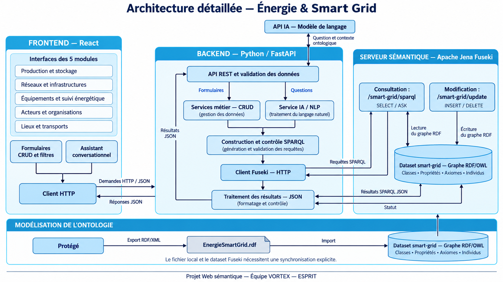

# Backend — Gestion des réseaux et des infrastructures

FastAPI reçoit une demande, spaCy détecte l'intention et les entités, Python construit une requête SPARQL validée puis l'envoie à Fuseki. Aucun changement frontend.

## Architecture



## Démarrage

Dans le dossier `WebSementiqueBackend` (PowerShell) :

```powershell
python -m venv .venv
.venv\Scripts\python -m pip install -r requirements.txt
.venv\Scripts\python -m uvicorn main:app --reload
```

Documentation interactive : http://localhost:8000/docs

Depuis le dossier parent `Projet`, le lancement fonctionne aussi :

```powershell
WebSementiqueBackend\.venv\Scripts\python -m uvicorn WebSementiqueBackend.main:app --reload
```

## Connexion Fuseki

Les variables sont regroupées au début de `main.py`, à la racine du backend.

| Variable | Valeur par défaut |
| --- | --- |
| `FUSEKI_BASE_URL` | `http://localhost:3030` |
| `FUSEKI_DATASET` | `smart-grid` |
| `FUSEKI_ENDPOINT` (environnement : `FUSEKI_QUERY_URL`) | `http://localhost:3030/smart-grid/sparql` |
| `FUSEKI_UPDATE_ENDPOINT` (environnement : `FUSEKI_UPDATE_URL`) | `http://localhost:3030/smart-grid/update` |
| `FUSEKI_USERNAME`, `FUSEKI_PASSWORD` | vides, sans authentification |
| `FUSEKI_TIMEOUT` | 15 secondes |
| `RDF_NAMESPACE` | `https://example.org/energie-smart-grid#` |
| `CORS_ORIGINS` | `http://localhost:5173,http://localhost:3000` |

L'URL `http://localhost:3030/#/dataset/smart-grid/query` est l'interface web. Les requêtes HTTP utilisent `/sparql` et `/update`. Le dataset doit contenir le RDF **et l'ontologie dans le graphe par défaut**. Les graphes nommés ne sont pas gérés. Les écritures doivent être autorisées dans Fuseki.

Configuration optionnelle dans le terminal qui lance Python :

```powershell
$env:FUSEKI_DATASET = "smart-grid"
$env:FUSEKI_USERNAME = "admin"
$env:FUSEKI_PASSWORD = "votre-mot-de-passe"
```

Le programme lit les variables d'environnement ; il ne charge pas de fichier `.env`.

## Correspondance avec le RDF

Ce sont deux collections API de ressources RDF, sans tables SQL :

- `reseaux` : `Reseau` et toutes ses sous-classes (électrique, distribution, transport, communication, micro-réseau…).
- `infrastructures` : `Ouvrage` (lignes, transformateurs) et `PosteCommande`, avec leurs sous-classes.

La classe `Infrastructure` n'existe pas dans le fichier fourni. Ce regroupement évite d'inventer une classe dans l'ontologie. Les chemins `rdf:type/rdfs:subClassOf*` retrouvent les individus typés uniquement par une sous-classe, même sans raisonneur Fuseki.

`GET /api/schema` expose les classes et propriétés compatibles par collection. Les noms RDF sont sensibles à la casse :

| Ressource | Exemples de propriétés |
| --- | --- |
| Réseau électrique | `tensionNominaleV`, `frequenceNominaleHz`, `niveauFiabilitePourcent`, `estGerePar`, `possedeLigne`, `possedeTransformateur` |
| Ligne | `tensionV`, `longueurKm`, `courantMaxA`, `appartientAuReseau` |
| Transformateur | `tensionEntreeV`, `tensionSortieV`, `puissanceNominaleKVA`, `rendementPourcent`, `estTransformateurDuReseau` |
| Poste de commande | `estPosteCommandeDe`, `surveilleInstallation`, `estSitueDans` |
| Propriétés générales | `etatService`, `referenceExploitation`, `dateMiseEnService` |

`localite` appartient à `Lieu` ; ce n'est pas un champ direct de réseau. « Réseaux à Tunis » recherche donc Tunis dans le **libellé** du réseau.

`ontology_schema.json` est un instantané des classes, domaines et portées du RDF fourni. À synchroniser si l'ontologie change. Il ne contient pas les individus.

## Routes CRUD

Remplacer `{collection}` par `reseaux` ou `infrastructures` :

| Méthode | Route | Fonction |
| --- | --- | --- |
| GET | `/api/{collection}` | Lister ; paramètres `type`, `search`, `limit` (1–200), `offset` |
| GET | `/api/{collection}/{id}` | Lire une ressource |
| POST | `/api/{collection}` | Créer |
| PATCH | `/api/{collection}/{id}` | Modifier certains champs |
| DELETE | `/api/{collection}/{id}` | Supprimer la ressource et ses relations entrantes |
| POST | `/api/nlp` | Traduire et exécuter une demande française |
| GET | `/api/schema` | Consulter les noms RDF autorisés |
| GET | `/api/health` | Vérifier la connexion de lecture Fuseki |

L'ancienne route `/api/equipements` reste disponible.

Exemple `POST /api/reseaux` :

```json
{
  "id": "reseau_demo",
  "type": "ReseauDistributionUrbain",
  "label": "Réseau démo Tunis",
  "properties": {
    "tensionNominaleV": 30000,
    "frequenceNominaleHz": 50,
    "etatService": "en service"
  }
}
```

Exemple `POST /api/infrastructures` (le réseau cible doit déjà exister) :

```json
{
  "id": "ligne_demo",
  "type": "LigneMoyenneTension",
  "label": "Ligne démo",
  "properties": {
    "tensionV": 30000,
    "longueurKm": 2.5,
    "appartientAuReseau": ["reseau_demo"]
  }
}
```

Exemple `PATCH /api/reseaux/reseau_demo` :

```json
{"properties": {"etatService": "hors service"}}
```

Un PATCH remplace toutes les valeurs des propriétés fournies ; les autres restent intactes. Pour retirer une propriété : `{"properties":{"etatService":[]}}`. Les identifiants et les classes sont immuables.

Les relations attendent un identifiant RDF (nom local, `eg:nom` ou URI complète de cette ontologie). Leur cible doit exister avec le type attendu. Les inverses ne sont pas matérialisés ni synchronisés automatiquement, y compris s'ils sont déjà présents explicitement dans le dataset.

Une lecture renvoie `data`, une liste de ressources avec `id`, `uri`, `properties`. Chaque propriété contient une liste de valeurs SPARQL JSON (`value`, `type`, et éventuellement `datatype` ou `xml:lang`). Le champ `sparql` contient la requête envoyée.

Erreurs : 422 (demande/valeur incompatible), 404 (ressource absente de la collection), 409 (identifiant utilisé), 502 (connexion/refus Fuseki), 504 (délai dépassé).

## Demandes spaCy

Le frontend pourra envoyer ce JSON à `POST /api/nlp` :

```json
{"prompt":"Affiche les réseaux à Tunis","execute":true}
```

Le pipeline utilise `spacy.blank("fr")` et `PhraseMatcher` : aucun service externe, clé API ou téléchargement de modèle linguistique. C'est une traduction à règles avec un vocabulaire limité ; elle ne traduit pas toute phrase arbitraire en SPARQL.

Exemples pris en charge :

```text
Affiche les réseaux
Affiche les réseaux électriques
Liste les réseaux de distribution
Affiche les réseaux à Tunis
Liste les transformateurs
Affiche les lignes haute tension
Affiche les réseaux dont la tension nominale est supérieure à 20000 V
Liste les lignes tensionV>=230
Affiche les réseaux id=reseau_distribution_ariana
Crée un réseau type=ReseauDistribution id=reseau_demo label="Réseau démo" tensionNominaleV=30000
Crée un transformateur type=Transformateur30kV400V id=transfo_demo tensionEntreeV=30000 tensionSortieV=400
Modifie le réseau id=reseau_demo etatService="hors service"
Supprime le transformateur id=transfo_demo
```

Pour les écritures, un `id=...` explicite est obligatoire. Les champs suivent la syntaxe `proprieteRDF=valeur` ; utiliser des guillemets doubles pour les valeurs contenant des espaces. Les relations et les valeurs multiples sont aussi accessibles via les routes CRUD JSON.

Les filtres symboliques `=`, `>`, `<`, `>=`, `<=` sont acceptés en lecture. Les comparaisons françaises `supérieure à`, `inférieure à`, `égale à`, `au moins`, `au plus` sont reconnues pour tension nominale, fréquence nominale, fiabilité, longueur, tension d'entrée, tension de sortie, puissance nominale et rendement. Les unités sont celles du nom RDF ; aucune conversion kV/V. Les négations, actions multiples, suppressions par groupe et demandes inconnues sont rejetées.

`"execute": false` renvoie la requête sans l'exécuter. Pour une écriture, la validation peut encore effectuer des lectures Fuseki (existence, types, relations).

## Vérification du RDF et tests

`verification_rdf.json` contient le contrôle du fichier fourni : 3786 triplets, 205 classes, 121 individus, 128 propriétés objet et 53 propriétés de données. Aucun terme local non déclaré ni littéral typé invalide détecté. Aucun conflit de classes disjointes détecté après les inférences simples du script. Ce contrôle ne remplace pas une validation OWL complète avec un raisonneur.

Point à revoir : `energieProduiteKWh` possède deux domaines, `CompteurIntelligent` et `SourceProduction`. Deux domaines impliquent une **intersection** : chaque sujet utilisant cette propriété est inféré comme appartenant aux deux classes. Si l'intention est « compteur OU source », déclarer un domaine `owl:unionOf` ou deux propriétés distinctes. Ce point concerne les équipements/sources, hors du module demandé. Le RDF original n'a pas été modifié.

```powershell
.venv\Scripts\python -m unittest -v test_backend
.venv\Scripts\python audit_rdf.py "..\..\Energie et Smart Grid\EnergieSmartGrid.rdf" --output verification_rdf.json
```

Les tests exécutent les SPARQL sur un graphe RDF isolé via un transport Fuseki simulé : CRUD des deux collections, traduction française, sous-classes, filtres, validation des relations, prévisualisation sans écriture, suppression des liens entrants et erreurs de connexion.

La connexion réelle a aussi été vérifiée en lecture : 11 réseaux et 18 infrastructures. Les tests ne vérifient pas toutes les restrictions OWL (cardinalités, etc.). Le backend de développement n'ajoute pas d'authentification aux routes HTTP.

Références : [endpoints Fuseki](https://jena.apache.org/documentation/fuseki2/fuseki-config-endpoint) et [règles spaCy](https://spacy.io/usage/rule-based-matching).
